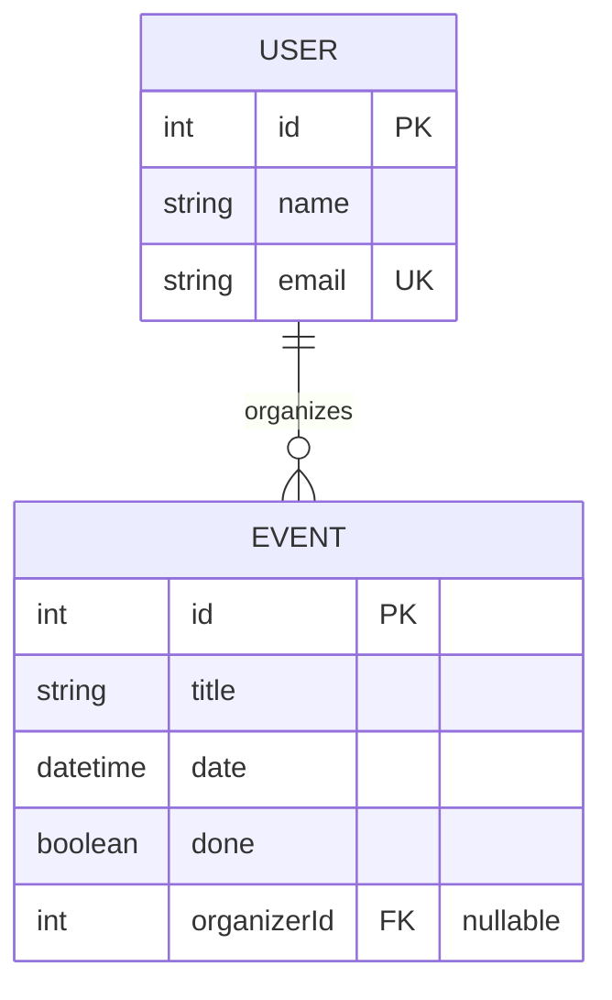

# ER Diagram — Team Events API

## Relationship notes

- One `User` can organize zero or many `Event` records.
- An `Event` can have zero or one organizer (`organizerId` is nullable).
- `User.id` is the primary key; `User.email` is unique.
- `Event.organizerId` is a nullable foreign key referencing `User.id`.
